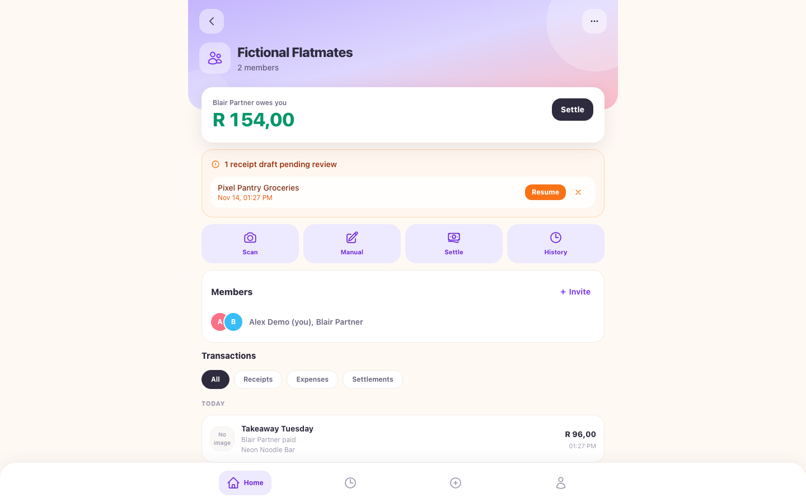
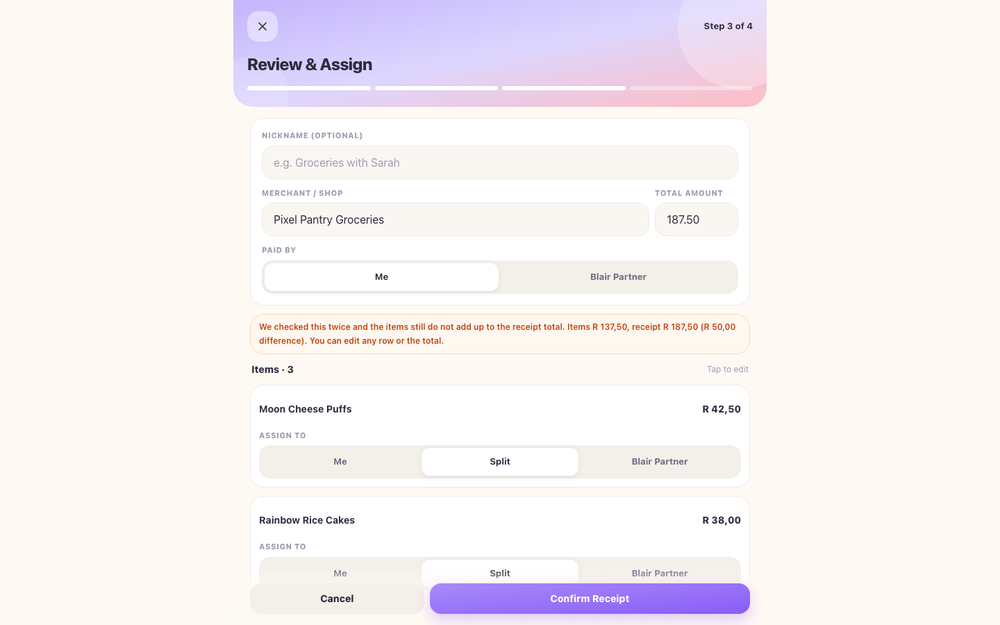
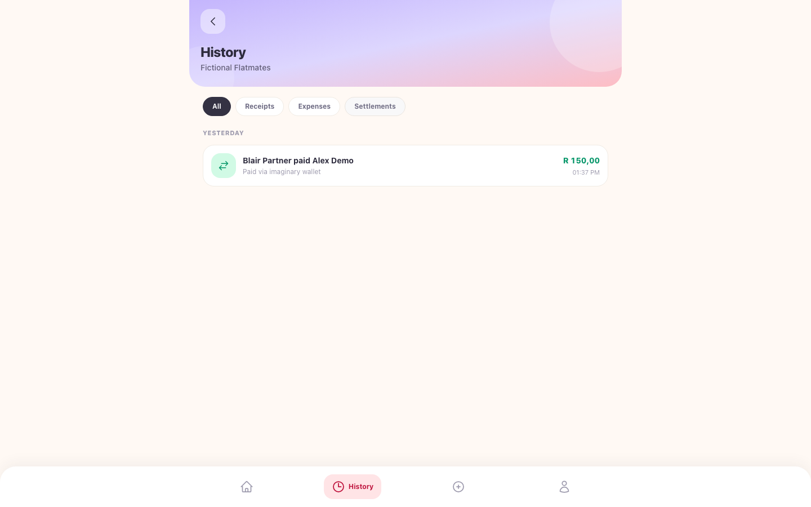

# SplitEasy

SplitEasy is a full-stack bill-splitting app for **two-member groups**. Upload receipt photos for OCR review, log manual expenses, record settlements, and see who owes whom. The Python package in `backend/pyproject.toml` is named `splitwise-api`; the product name is SplitEasy.



## Overview

A user creates a group and invites one other person (by email or a six-character join code). The API enforces the two-member limit. Members upload receipts (OpenRouter structured OCR), assign line items, add manual entries, and record settlements. Balances combine assigned receipts, manual splits, and settlement history. See [docs/balance-calculation.md](docs/balance-calculation.md) for how net amounts are computed.

## Features

- **Two-person groups** with owner/member roles, invitations, and join codes
- **Receipt OCR** via OpenRouter (`OPENROUTER_MODEL`, default `google/gemini-2.5-flash`)
- **Line-item assignment** before a receipt affects balances
- **Manual expenses** with equal, full, or percentage splits
- **Settlements** and suggested payoffs between members
- **JWT access tokens** plus HttpOnly refresh cookies on `/api/auth`

## Screenshots

| View | Description |
| --- | --- |
|  | Group home with balances |
|  | Receipt line items on review |
|  | Settlement history filter |

## Architecture

```mermaid
flowchart TB
  subgraph browser [Browser]
    SPA[React SPA]
  end
  subgraph app_repo [This repository]
    FE[frontend nginx or Vite]
    BE[FastAPI backend]
  end
  subgraph bundled [Dev or standalone]
    PG[(Postgres 15)]
  end
  subgraph panel [VPS control panel — not in this repo]
    NGX[nginx + TLS]
    IMG[Prebuilt Docker Hub images]
    EXT_PG[(Shared Postgres on postgres-net)]
  end
  SPA --> FE
  FE -->|/api| BE
  BE --> PG
  BE -->|OCR| OR[OpenRouter]
  IMG -.->|docker-compose.yml| BE
  IMG -.-> FE
  BE -.-> EXT_PG
  NGX -.-> FE
```



**Standalone / dev:** `docker-compose.dev.yml` or `docker-compose.standalone.yml` run Postgres inside the project, build from Dockerfiles, and publish the frontend on `${FRONTEND_PORT:-3000}`. The backend talks to `POSTGRES_HOST=postgres` on an internal `postgres-net` bridge.

**Control panel (this VPS):** `docker-compose.yml` is the deploy contract. The panel pulls `andrewallkin/spliteasy:${DOCKER_IMAGE_BACKEND}` and `:${DOCKER_IMAGE_FRONTEND}`, joins the **external** network `postgres-net`, binds **127.0.0.1** host ports, writes production `.env`, runs `bash /app/run_migrations.sh`, and checks **`GET /api/health`**. TLS, shared Postgres, and nginx live in the panel—not here.

## Technology stack

| Layer | Technology |
| --- | --- |
| Backend | FastAPI, SQLAlchemy (async), Alembic, PostgreSQL (asyncpg) |
| Frontend | React 19, TypeScript, Vite, Tailwind, React Router 7 |
| Auth | JWT access tokens, refresh cookies, bcrypt passwords |
| OCR | OpenRouter API |
| Tooling | `uv`, Docker Compose, GitHub Actions → Docker Hub |

## Getting started

1. Copy [`.env.example`](.env.example) to `.env` and set at least `JWT_SECRET_KEY` (and `OPENROUTER_API_KEY` if you test OCR).
2. Start development:

   ```bash
   docker compose -f docker-compose.dev.yml up --build
   ```

3. Migrate:

   ```bash
   docker compose -f docker-compose.dev.yml exec backend uv run alembic upgrade head
   ```

4. Open **http://localhost:3000** (adjust for `FRONTEND_PORT`). API docs: **http://localhost:8000/docs**.

**Optional demo data** (fictional names and amounts; local database only):

```bash
docker compose -f docker-compose.standalone.yml exec backend uv run python scripts/seed_demo.py --reset
```

Sign in with **`demo@example.com`** / **`password123`** after seeding.

## Configuration

All settings are documented in [`.env.example`](.env.example). Backend settings load from `.env` via Pydantic (`backend/app/config.py`). For dev and standalone, use `POSTGRES_HOST=postgres`. The panel overrides `POSTGRES_*` and image tags in production.

## Deployment

| Mode | Compose file | Notes |
| --- | --- | --- |
| Local development | `docker-compose.dev.yml` | Reload, Vite dev server, bundled Postgres |
| Standalone | `docker-compose.standalone.yml` | Production images, bundled Postgres, no panel |
| This VPS | `docker-compose.yml` | Image mode, external `postgres-net`, loopback ports |

Details: [docs/deployment.md](docs/deployment.md).

## API

All JSON routes are under **`/api`**. Health: **`GET /api/health`**. Interactive OpenAPI UI: **`GET /docs`** on the backend (port **8000** in dev; loopback in standalone/production).

Core surface area: `/api/auth`, `/api/users`, `/api/groups` (members, balances, history, invitations), `/api/receipts`, `/api/entries`, `/api/settlements`. Balance math is described in [docs/balance-calculation.md](docs/balance-calculation.md) rather than duplicating every field here.

## Development and tests

| Task | Command |
| --- | --- |
| Lint | `make lint` |
| Backend tests | `make test` |
| Migrate (dev compose) | `make migrate` |
| Standalone migrate | `docker compose -f docker-compose.standalone.yml exec backend bash /app/run_migrations.sh` |
| Seed demo data | `docker compose -f docker-compose.standalone.yml exec backend uv run python scripts/seed_demo.py --reset` |
| Capture README screenshots | `npm install && npm run capture-screenshots` (standalone stack up, migrated, seeded; uses Playwright at 1440×900) |

GitHub Actions (`.github/workflows/ci.yml`) runs backend pytest and frontend lint on pull requests. `.github/workflows/deploy.yml` builds and pushes Docker images on `main`; it does not deploy or migrate.