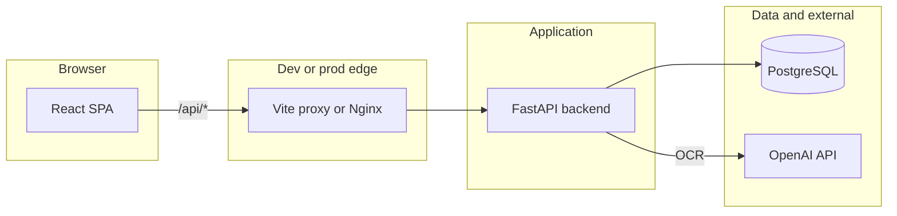

# SplitEasy

Full-stack bill-splitting application (MVP scope: **two members per group**). The repository root is **SplitEasy**; the Python distribution name in `backend/pyproject.toml` is `splitwise-api`.

## Table of contents

- [What it does](#what-it-does)
- [Architecture](#architecture)
- [Repository layout](#repository-layout)
- [Prerequisites](#prerequisites)
- [Environment variables](#environment-variables)
- [Local development](#local-development)
- [Makefile shortcuts](#makefile-shortcuts)
- [Database and migrations](#database-and-migrations)
- [Authentication and sessions](#authentication-and-sessions)
- [Domain: balances, receipts, and settlements](#domain-balances-receipts-and-settlements)
- [HTTP API reference](#http-api-reference)
- [Receipts and OCR](#receipts-and-ocr)
- [Frontend](#frontend)
- [Production deployment](#production-deployment)
- [CI/CD (GitHub Actions)](#cicd-github-actions)
- [Testing and linting](#testing-and-linting)
- [Troubleshooting](#troubleshooting)
- [Further reading](#further-reading)

---

## What it does

- **Groups**: A user creates a group and becomes the **owner**. A second user joins via an **invitation** (email-bound flow with `invitation_id`, or a **6-character join code**). The API rejects joins and invites when the group already has two members (see `backend/app/api/routes/groups.py`).
- **Receipts**: Upload receipt images; the backend normalizes images (including HEIC), runs **OpenAI** structured OCR (`backend/app/services/ocr.py`), lets users review line items, assign shares, then marks the receipt **`assigned`** so it affects balances.
- **Manual entries**: Log expenses without a receipt, with split types `equal`, `full`, or `percentage` (`backend/app/api/routes/entries.py`).
- **Settlements**: Record payments between members; included in balance math (`backend/app/services/balances.py`).
- **Balances**: Per-member net amounts derived from assigned receipts, manual entries, and settlements.

**Stack**

| Layer | Technology |
| --- | --- |
| Backend | FastAPI, SQLAlchemy (async), Alembic, PostgreSQL (asyncpg), Pydantic Settings |
| Frontend | React 19, TypeScript, Vite, Tailwind (via project styling), React Router 7, Axios |
| OCR | OpenAI API (`OPENAI_MODEL`, default `gpt-4o`) |
| Tooling | `uv` (Python), Docker Compose |

---

## Architecture

All JSON API routes are mounted under **`/api`** (`backend/app/api/router.py`). Interactive docs: **`GET /docs`** on the backend host (Swagger UI). Health: **`GET /api/health`** (`backend/app/main.py`).



**Development** (`docker-compose.dev.yml`): Compose runs **PostgreSQL 15**, the **backend** (Uvicorn with reload), and the **frontend** (Vite dev server on container port **5173**, published to host **`FRONTEND_PORT`** default **3000**). The frontend service sets `API_PROXY_ORIGIN=http://backend:8000` so Vite proxies `/api` to the backend (`frontend/vite.config.ts`).

**Production** (`docker-compose.yml`): No Postgres service in this file; the backend joins an **external** Docker network **`postgres-net`** so it can reach a database already attached to that network. The frontend image serves static assets on **port 80** inside the container, mapped to host **`FRONTEND_PORT`**.

---

## Repository layout

| Path | Role |
| --- | --- |
| `backend/app/main.py` | FastAPI app, CORS, global exception handler, startup (upload dir) |
| `backend/app/api/` | Routers (`routes/`), `deps.py` (auth, group membership) |
| `backend/app/core/` | Settings, security (JWT, passwords) |
| `backend/app/db/` | Async session, engine |
| `backend/app/models/` | SQLAlchemy models |
| `backend/app/schemas/` | Pydantic request/response models |
| `backend/app/services/` | Balances, OCR |
| `backend/alembic/` | Migration env and `versions/` |
| `backend/run_migrations.sh` | Waits for DB, runs `alembic upgrade head` (used in prod-style deploys) |
| `frontend/src/` | `pages/`, `api/`, `context/`, `router/`, `components/` |
| `docker-compose.dev.yml` | Local full stack with Postgres |
| `docker-compose.yml` | Production-style app containers |
| `.env.example` | Environment template |
| `Makefile` | Common dev commands |
| `.github/workflows/deploy.yml` | VPS deploy pipeline |

Host directory **`./data`** is mounted at **`/app/data`** in both compose files for file-backed data alongside configurable `UPLOADS_DIR`.

---

## Prerequisites

- **Docker** and **Docker Compose** (recommended path).
- For running services on the host: **Python 3.12+**, **[uv](https://github.com/astral-sh/uv)**, and a current **Node.js** LTS (see `frontend/package.json` for toolchain hints).

---

## Environment variables

Configuration is loaded from **`.env`** in the backend working directory (`backend/app/core/settings.py` uses `env_file=".env"`). Keys in `.env` use **SCREAMING_SNAKE_CASE**; the settings class maps them to **snake_case** fields (e.g. `POSTGRES_DB` → `postgres_db`).

| Variable | Purpose |
| --- | --- |
| `ENVIRONMENT` | Logical environment name (e.g. `development`, `production`). |
| `APP_NAME` | FastAPI title string. |
| `POSTGRES_DB`, `POSTGRES_USER`, `POSTGRES_PASSWORD`, `POSTGRES_HOST`, `POSTGRES_PORT` | Async PostgreSQL URL pieces (`postgresql+asyncpg://...`). |
| `JWT_SECRET_KEY` | Secret for signing JWT access and refresh tokens. Use a long random value in production. |
| `JWT_ACCESS_TOKEN_EXPIRE_MINUTES` | Short-lived access token TTL. |
| `JWT_REFRESH_TOKEN_EXPIRE_DAYS` | Refresh token TTL (cookie max-age aligned in auth routes). |
| `CORS_ALLOWED_ORIGINS` | Comma-separated browser origins allowed by CORS (no spaces required; values are trimmed). Must include the exact origin users type in the address bar (scheme + host + port). |
| `COOKIE_SECURE` | If `true`, refresh cookie is **Secure** (HTTPS only). Set `true` in production behind TLS. |
| `AUTHORIZED_EMAILS` | Optional comma-separated allowlist for **register** and **login**. If empty, any email is allowed. If set, only listed emails (case-insensitive) may authenticate. |
| `OPENAI_API_KEY` | Required for receipt OCR. |
| `OPENAI_MODEL` | Model id passed to the OpenAI client (default `gpt-4o` in `.env.example`). |
| `UPLOADS_DIR` | Filesystem path where the backend stores uploads; created on startup. In Docker, align with bind mounts (e.g. `/app/data` if that is where you persist files). |
| `BACKEND_PORT` | Host port published for the backend (compose). |
| `FRONTEND_PORT` | Host port published for the frontend (compose). |
| `DOMAIN` | Documented in templates for operators; wire to your reverse proxy and `CORS_ALLOWED_ORIGINS`. |

**CORS and cookies**: The browser sends the refresh cookie on requests whose URL path matches the cookie path **`/api/auth`**. Access tokens are sent manually via the **`Authorization`** header (`Bearer` plus JWT; see `frontend/src/api/client.ts`). For cross-origin setups, origins must be listed in `CORS_ALLOWED_ORIGINS`, and `COOKIE_SECURE` / `SameSite` behavior must match your deployment (see auth section).

---

## Local development

### Recommended: Docker Compose (dev file)

1. Copy **`.env.example`** to **`.env`** and adjust secrets and ports.
2. Start the stack:

   ```bash
   docker compose -f docker-compose.dev.yml up --build
   ```

   Or detached: `docker compose -f docker-compose.dev.yml up -d --build`.

3. Apply database migrations (once per fresh database):

   ```bash
   docker compose -f docker-compose.dev.yml exec backend uv run alembic upgrade head
   ```

4. Open the app:
   - Frontend: `http://localhost:3000` (or `http://127.0.0.1:3000` if you use that origin—ensure it appears in `CORS_ALLOWED_ORIGINS`).
   - API docs: `http://localhost:8000/docs`.

### Optional: install dependencies on the host

- Backend: `cd backend && uv sync --all-extras`
- Frontend: `cd frontend && npm install`

Run API: `cd backend && uv run uvicorn app.main:app --reload --host 0.0.0.0 --port 8000`  
Run UI: `cd frontend && npm run dev` (Vite defaults to port **5173** unless configured otherwise).

With a local Vite dev server, **`/api`** is proxied to **`API_PROXY_ORIGIN`** if set, otherwise **`http://127.0.0.1:8000`** (`frontend/vite.config.ts`). Use a **`.env`** or shell export so the proxy points at your running backend.

---

## Makefile shortcuts

From the repo root (`Makefile`):

| Target | Command |
| --- | --- |
| `dev-build` | `docker compose -f docker-compose.dev.yml up --build` |
| `dev-build-d` | Same, detached |
| `dev-up` / `dev-up-d` | Up without rebuild |
| `dev-down` | `docker compose -f docker-compose.dev.yml down` |
| `migrate` | Exec backend: `uv run alembic upgrade head` |
| `lint` | `ruff` in backend, `npm run lint` in frontend |
| `test` | `uv run pytest` in backend |
| `build` | `npm run build` in frontend |

---

## Database and migrations

**Policy**: **Alembic is the single source of truth** for schema. On a new database, create tables with `alembic upgrade head`. Model changes should be accompanied by new revision scripts under `backend/alembic/versions/`.

Common commands (from `backend/` with `.env` present):

```bash
uv run alembic upgrade head
uv run alembic current
uv run alembic revision --autogenerate -m "describe change"   # when applicable
```

**Production-style migrations**: `backend/run_migrations.sh` loops until `alembic current` succeeds, prints status, runs `alembic upgrade head`, and prints the final revision. The GitHub deploy workflow invokes this inside the backend container.

---

## Authentication and sessions

**Registration and login** (`backend/app/api/routes/auth.py`):

- Response body includes a short-lived **access token** (JWT) and user payload (`AuthResponse`).
- An HTTP-only **`refresh_token`** cookie is set on the response: path **`/api/auth`**, `SameSite=lax`, `Secure` controlled by **`COOKIE_SECURE`**.

**Refresh**:

- `POST /api/auth/refresh` reads the cookie, validates the JWT **jti** against the `RefreshToken` table, implements **rotation** (marks old row used, issues new refresh), and returns a new access token. If a **used** refresh token is presented again, the whole **token family** is revoked (reuse / theft detection).

**Logout**:

- `POST /api/auth/logout` requires a valid access token, revokes all refresh token rows for the user, clears the cookie.

**Protected routes**:

- `Authorization: Bearer` JWT in the header; `get_current_user` decodes JWT, loads `User`, enforces `is_active` (`backend/app/api/deps.py`).

---

## Domain: balances, receipts, and settlements

**Receipt lifecycle** (`backend/app/models/enums.py`): `pending_ocr` → `pending_review` → `confirmed` → **`assigned`**, with `ocr_failed` as a failure state.

**Balance computation** (`backend/app/services/balances.py`):

- **Receipts**: Only receipts with **`status == assigned`** contribute. For each assigned line item, **non-payer** assignees owe their **`share_amount`** to the **payer**, where payer is **`paid_by_user_id`** if set, otherwise **`uploaded_by`**.
- **Manual entries**: The **creator** is treated as the payer; each split row debits that member and credits the creator by the split **amount** (see implementation for rounding rules in the entries router).
- **Settlements**: **`paid_by`** is credited and **`paid_to`** debited by the settlement **amount** (sign convention in code).

**Group balances endpoint** (`GET /api/groups/{group_id}/balances`) recomputes totals, persists snapshots in `GroupBalance`, and returns `balances`, `is_settled`, and `total_owed`.

**UI mapping**: React routes in `frontend/src/router/AppRouter.tsx` cover group list and detail, receipt upload, manual entry, history, settle, profile, and join flows—each backed by the API above.

---

## HTTP API reference

Prefix for all routes below: **`/api`**, except **health** which is registered on the app at **`/api/health`**. Authenticated routes expect a **`Bearer`** JWT in **`Authorization`** unless noted.

### Auth (`backend/app/api/routes/auth.py`)

| Method | Path | Description |
| --- | --- | --- |
| POST | `/auth/register` | Create user; sets refresh cookie; returns access token + user. |
| POST | `/auth/login` | Login; sets refresh cookie; returns access token + user. |
| POST | `/auth/refresh` | Uses refresh cookie; returns new access token; rotates refresh. |
| POST | `/auth/logout` | Revokes refresh tokens; clears cookie (requires Bearer access). |

### Users (`backend/app/api/routes/users.py`)

| Method | Path | Description |
| --- | --- | --- |
| GET | `/users/me` | Current user profile. |
| PATCH | `/users/me` | Update display name and/or profile picture (base64 rules in handler). |
| POST | `/users/me/password` | Change password (`204` on success). |

### Groups (`backend/app/api/routes/groups.py`)

| Method | Path | Description |
| --- | --- | --- |
| POST | `/groups` | Create group (creator becomes owner). |
| GET | `/groups` | List groups for current user. |
| POST | `/groups/join-by-code` | Body: `{ "code": "ABCDEF" }` (six-character code). Join via join code. |
| GET | `/groups/history` | Cross-group history for current user. Query: optional **`type`** (omit for all, or `receipt`, `entry`, or `settlement`), optional **`group_id`** (must be a group the user belongs to). |
| GET | `/groups/{group_id}` | Group detail. |
| PATCH | `/groups/{group_id}` | Update group name. |
| PATCH | `/groups/{group_id}/profile-picture` | Set group picture (base64). |
| DELETE | `/groups/{group_id}` | Delete group (per rules in handler). |
| GET | `/groups/{group_id}/members` | List members. |
| POST | `/groups/{group_id}/invite` | Invite by email; returns `invitation_id` and `join_code`. |
| GET | `/groups/{group_id}/invitations` | List invitations with status. |
| POST | `/groups/{group_id}/join` | Body: `{ "invitation_id": "…" }` (UUID; invitation must belong to this `group_id`). |
| DELETE | `/groups/{group_id}/members/{user_id}` | Remove member (owner rules apply). |
| GET | `/groups/{group_id}/balances` | Computed balances + persisted snapshot. |
| GET | `/groups/{group_id}/history` | Group-scoped history. Query: optional **`type`** (same values as `/groups/history`). |

### Manual entries and settlements (`backend/app/api/routes/entries.py`)

Router prefix: **`/groups/{group_id}`**.

| Method | Path | Description |
| --- | --- | --- |
| POST | `/groups/{group_id}/entries` | Create manual entry. |
| GET | `/groups/{group_id}/entries` | List entries. |
| GET | `/groups/{group_id}/entries/{entry_id}` | Entry detail. |
| PATCH | `/groups/{group_id}/entries/{entry_id}` | Update entry. |
| DELETE | `/groups/{group_id}/entries/{entry_id}` | Delete entry. |
| POST | `/groups/{group_id}/settlements` | Create settlement. |
| GET | `/groups/{group_id}/settlements` | List settlements. |

### Receipts (`backend/app/api/routes/receipts.py`)

| Method | Path | Description |
| --- | --- | --- |
| POST | `/groups/{group_id}/receipts` | Multipart upload; creates receipt, runs OCR pipeline. |
| GET | `/groups/{group_id}/receipts` | List receipts in group. |
| GET | `/receipts/{receipt_id}` | Receipt detail. |
| PATCH | `/receipts/{receipt_id}` | Patch metadata / status transitions as implemented. |
| DELETE | `/receipts/{receipt_id}` | Delete receipt and related rows. |
| GET | `/receipts/{receipt_id}/items` | Line items for editing. |
| PUT | `/receipts/{receipt_id}/items` | Replace/update line items from client. |
| POST | `/receipts/{receipt_id}/assign` | Assign shares; moves toward `assigned` when valid. |
| GET | `/receipts/{receipt_id}/image` | Fetch receipt image bytes. |

### System

| Method | Path | Description |
| --- | --- | --- |
| GET | `/api/health` | JSON health payload (no auth). |

---

## Receipts and OCR

1. Client uploads one or more image files to **`POST /api/groups/{group_id}/receipts`**.
2. Backend converts images to **JPEG** where needed (JPEG passthrough, HEIC via `pillow-heif`, other raster via Pillow) (`backend/app/services/ocr.py`).
3. **OpenAI** returns structured line items; persistence and status transitions are handled in `receipts` routes and models.
4. User reviews items (`GET`/`PUT` `/api/receipts/{id}/items`), then **`POST /api/receipts/{id}/assign`** applies **ShareType** rules (`full`, `equal`, `percentage` in `backend/app/models/enums.py`).
5. Once **`assigned`**, line items affect **`compute_group_balances`**.

Without a valid **`OPENAI_API_KEY`**, OCR-dependent steps will fail at runtime.

---

## Frontend

- **Entry**: `frontend/src/main.tsx`, `frontend/src/App.tsx`.
- **Routing**: `frontend/src/router/AppRouter.tsx` — public **`/login`**, **`/register`**; protected **`/`** (group list), **`/groups/:id`**, **`/groups/:id/upload`**, **`/groups/:id/manual`**, **`/groups/:id/history`**, **`/groups/:id/settle`**, **`/join/:groupId`**, **`/history`**, **`/add`**, **`/profile`**.
- **API client**: `frontend/src/api/client.ts` — Axios instance with `baseURL: '/api'`, **`withCredentials: true`**, in-memory access token, **401** retry after **`POST /auth/refresh`**.
- **Auth state**: `frontend/src/context/AuthContext.tsx`; route guards in `frontend/src/components/layout/ProtectedRoute.tsx`.

Vite **`server.allowedHosts`** includes several **ngrok** suffixes for tunneling during development (`frontend/vite.config.ts`).

Additional Vite-specific notes may appear in `frontend/README.md`.

---

## Production deployment

**Docker Compose** (`docker-compose.yml`):

- Declare an **external** network named **`postgres-net`** on the host (`docker network create postgres-net` once), and attach your PostgreSQL container to it so the backend can resolve `POSTGRES_HOST`.
- Services: **backend** and **frontend** only; backend publishes **`BACKEND_PORT`**, frontend publishes **`FRONTEND_PORT`** → container **80**.
- Bind mount **`./data:/app/data`** for durable files; set **`UPLOADS_DIR`** inside the container to a path under that mount if you want uploads on disk to survive restarts.

**Reverse proxy (example shape only)**

Terminates TLS and routes by path (adjust `server_name`, ports, and upstreams):

```nginx
server {
    listen 443 ssl;
    server_name your.domain;

    location /api/ {
        proxy_pass http://127.0.0.1:8000/api/;
        proxy_http_version 1.1;
        proxy_set_header Host $host;
        proxy_set_header X-Forwarded-Proto $scheme;
        proxy_set_header X-Forwarded-For $proxy_add_x_forwarded_for;
    }

    location / {
        proxy_pass http://127.0.0.1:3000/;
        proxy_http_version 1.1;
        proxy_set_header Host $host;
        proxy_set_header Upgrade $http_upgrade;
        proxy_set_header Connection "upgrade";
    }
}
```

Use your real **`FRONTEND_PORT`** / **`BACKEND_PORT`** bindings instead of `8000`/`3000` if they differ. Set **`CORS_ALLOWED_ORIGINS`** to your public **`https://your.domain`** origin and **`COOKIE_SECURE=true`** when serving over HTTPS.

**Security checklist**

- Strong, unique **`JWT_SECRET_KEY`**.
- Database credentials and network isolation.
- TLS at the edge; secure cookies enabled.
- Minimal, accurate **CORS** allowlist.

---

## CI/CD (GitHub Actions)

Workflow: **`.github/workflows/deploy.yml`**

**Triggers**: push to **`main`**, or **workflow_dispatch**.

**Steps (summary)**:

1. Checkout; configure SSH key from secrets; add remote host to `known_hosts`.
2. SSH to the VPS and:
   - `cd /srv/apps`; derive repo directory name from `github.repository`.
   - Clone with **`GH_USERNAME`** / **`GH_PAT`** on first run, or fetch/reset to the deploy branch.
   - Write **`.env`** on the server from injected environment variables (mirrors `.env.example` fields).
   - **`docker compose down --remove-orphans`**, then **`docker image prune -a -f`** and **`docker builder prune -a -f`** (see caveat below).
   - **`docker compose build`**, **`docker compose up -d --force-recreate`**.
   - **`docker compose exec -T backend bash -c "cd /app && ./run_migrations.sh"`**.

**GitHub Actions secrets** (consumed in the workflow or SSH script):

| Secret | Role |
| --- | --- |
| `VPS_SSH_KEY`, `VPS_HOST`, `VPS_PORT`, `VPS_USER` | SSH access to the server. |
| `GH_USERNAME`, `GH_PAT` | HTTPS git clone/fetch from GitHub on the VPS. |
| `ENVIRONMENT`, `APP_NAME` | App metadata. |
| `POSTGRES_DB`, `POSTGRES_USER`, `POSTGRES_PASSWORD`, `POSTGRES_HOST`, `POSTGRES_PORT` | Database connection written to `.env`. |
| `JWT_SECRET_KEY`, `JWT_ACCESS_TOKEN_EXPIRE_MINUTES`, `JWT_REFRESH_TOKEN_EXPIRE_DAYS` | JWT configuration. |
| `CORS_ALLOWED_ORIGINS`, `COOKIE_SECURE` | Browser integration. |
| `AUTHORIZED_EMAILS` | Optional email allowlist (may be empty). |
| `OPENAI_API_KEY`, `OPENAI_MODEL` | OCR. |
| `UPLOADS_DIR`, `BACKEND_PORT`, `FRONTEND_PORT`, `DOMAIN` | Paths and ports on the VPS. |

**Operational caveat**: The workflow runs **global** `docker image prune` and **`docker builder prune`** on the VPS. That can remove unused images and build cache **for all projects on the host**, not only this repository. Review before relying on this in shared hosting environments.

---

## Testing and linting

**Backend tests**: from `backend/`, `uv run pytest` (see `backend/tests/`). The Makefile **`test`** target runs the same.

**Lint**: `make lint` runs **`ruff check`** on the backend and **`npm run lint`** in the frontend.

---

## Troubleshooting

| Symptom | Things to check |
| --- | --- |
| `401` / “Missing credentials” on API | Access token missing from `Authorization` header; user logged out or storage cleared. |
| Endless auth failures after deploy | **`CORS_ALLOWED_ORIGINS`** must match the site origin; **`COOKIE_SECURE`** must be `false` on plain HTTP and `true` on HTTPS. |
| Refresh never succeeds | Cookie path is `/api/auth`; ensure requests go to the same site and path prefix the proxy forwards correctly. |
| Tables missing / 500 on first run | Run **`alembic upgrade head`** (or `make migrate` in dev). |
| Production backend cannot reach Postgres | **`postgres-net`** must exist and both DB and backend containers must attach to it; **`POSTGRES_HOST`** must be the DB service name on that network. |
| OCR or upload errors | Valid **`OPENAI_API_KEY`**, model id, network egress from the backend container, and sufficient disk under **`UPLOADS_DIR`**. |
| Join or invite fails with “Group already full” | MVP limit of **two members** per group. |

---

## Further reading

- OpenAPI schema: `/openapi.json` on the running backend.
- Alembic revisions: `backend/alembic/versions/`.
- Frontend bundle analysis and Vite defaults: `frontend/README.md`.
